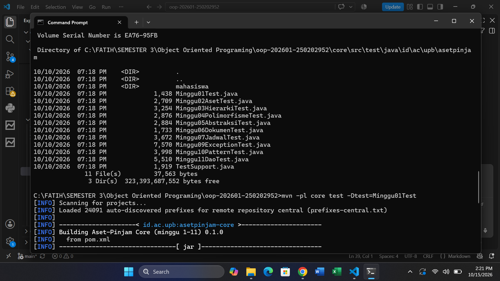
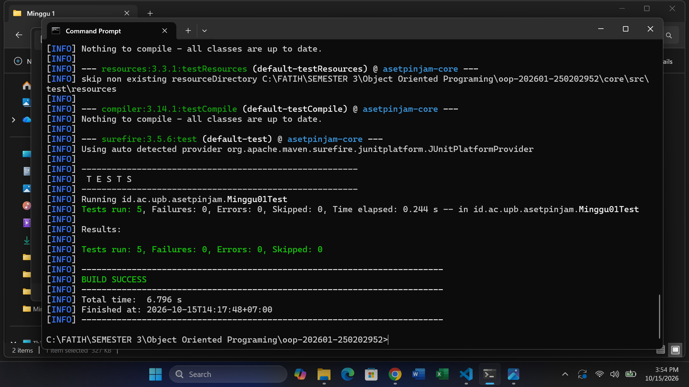
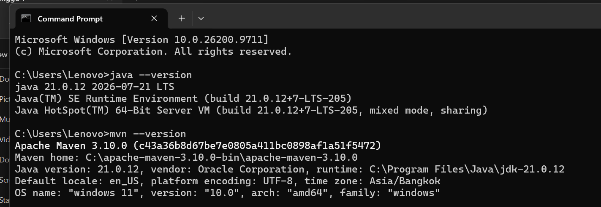

# Catatan Minggu 01: Paradigma Pemrograman dan Setup

## Yang saya kerjakan
- Mengisi tiga file Java: `HelloProsedural`, `HelloOOP`, dan `HelloFungsional`. Ketiganya menghasilkan kalimat sapaan yang sama, yaitu memuat "Aset-Pinjam", nama, dan NIM.
- Mengisi mahasiswa.properties, memasang dan mengecek JDK 21 dan Maven, lalu menjalankan tes sampai hasilnya BUILD SUCCESS dengan 5 tes lolos.

## Keputusan desain
Kalimat sapaan dibuat sama persis di ketiga gaya: "Halo [nama] (NIM [nim]), selamat datang di Aset-Pinjam!". Saya sengaja menyamakannya supaya mudah membandingkan cara kerja tiap gaya, karena hasilnya harus sama.

## Kendala
- Kendala pertama, sempat menjalankan perintah dari folder yang salah    (C:\WINDOWS\System32), jadi script uji.ps1 tidak ditemukan. Saya mengatasinya dengan pindah ke folder proyek memakai perintah cd.
- Kendala kedua, perintah "bash scripts/uji.sh" tidak dikenali karena komputer saya Windows dan tidak punya bash. Saya lalu mencoba cara lain dengan menjalankan Maven langsung dari Command Prompt.
- Kendala ketiga, saat menjalankan script hasilnya "Tests run: 0", artinya belum ada tes yang benar-benar jalan. Kemudian menjalankan perintah mvn -pl core test -Dtest=Minggu01Test di Command Prompt, dan hasilnya 5 tes lolos dengan BUILD SUCCESS.
- Kendala keempat, di HelloFungsional.java masih ada sisa potongan baris throw yang tidak terhapus, sehingga kodenya error. Saya menghapus baris sisa itu dan kodenya jadi benar.

## Penggunaan AI
- Alat yang dipakai: Claude ai
- Bagian yang dibantu AI: menjelaskan konsep minggu 1, menunjukkan bagian kode yang harus diisi, membantu menulis isi method di tiga file Java, dan membantu membaca error saat menjalankan tes
- Prompt utama: Kenapa tes saya masih belum bisa dijalankan? Ini pesan error-nya.
- Yang saya ubah atau tolak dari saran AI, dan alasannya: Kode dari AI saya pakai setelah saya pahami. Saya hanya mengubah cara menjalankan tes, dari "bash scripts/uji.sh" menjadi "mvn -pl core test -Dtest=Minggu01Test", karena bash tidak ada di Windows saya. Saya juga memperbaiki sendiri sisa baris throw yang tidak terhapus.
- Satu hal yang saya pahami lebih baik sekarang:"Hasil Tests run: 0" bukan berarti berhasil, karena tesnya belum benar-benar dijalankan, walaupun Maven tetap menulis BUILD SUCCESS.

## Dokumentasi

