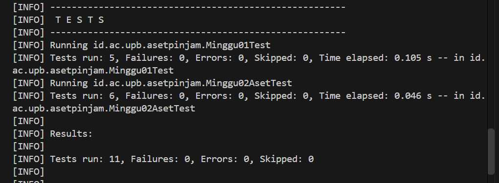
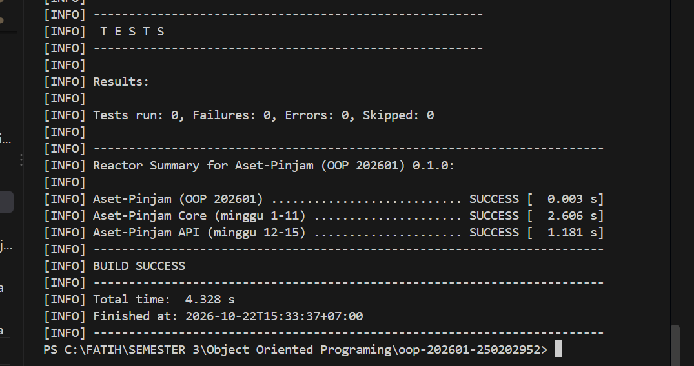

# Catatan Minggu 02: Struktur OOP: Class, Object, Encapsulation

## Yang saya kerjakan
- Melengkapi class `Aset` di file `Aset.java`
- Menulis empat field private (kode, nama, status, kondisi), dengan status dan kondisi punya nilai awal TERSEDIA dan BAIK.
- Membuat konstruktor yang menolak kode dan nama yang null atau kosong, empat getter, serta setter untuk nama, status, dan kondisi yang juga ada validasinya. Kode sengaja tidak saya beri setter karena menurut aturan yang ada itu Kode tidak boleh punya setter. Setelah selesai, saya jalankan tes minggu 1 dan 2 dan semuanya lolos.

## Keputusan desain
- Semua field di class `Aset` saya buat private, jadi data hanya bisa dibaca lewat getter dan diubah lewat setter. Dengan begitu setiap perubahan bisa diperiksa dulu sebelum disimpan. Kalau nilainya tidak layak (null atau kosong), program langsung melempar `IllegalArgumentException`, dan data yang lama tidak berubah.

- Status dan kondisi saya beri nilai awal langsung di field (TERSEDIA dan BAIK), jadi setiap aset yang baru dibuat sudah dalam keadaan jelas tanpa perlu diisi dari luar.

- Kode saya buat tanpa setter, karena kode itu identitas aset dan hanya diisi sekali saat object dibuat. Kode saya simpan apa adanya, tanpa trim atau diubah ke huruf besar, karena tugas hanya meminta kode tidak boleh null atau kosong. Untuk memeriksanya saya pakai `if` karena paling mudah saya baca.

## Kendala
1. Pada saat menjalankan `.\scripts\uji.ps1` di terminal VS Code muncul error karena script PowerShell diblokir oleh Execution Policy. Saya mengatasinya dengan menjalankan `Set-ExecutionPolicy -Scope Process -ExecutionPolicy Bypass` yang hanya berlaku di terminal yang sedang dijalankan . Setelah itu script jalan.

2. Saya sempat mengira tes minggu 2 sudah jalan, padahal yang tampil baru minggu 1. Setelah saya jalankan `.\scripts\uji.ps1 2` yang dimana saya menambahkan angka 2 ,baru setelah itu tes minggu 1 dan 2 jalan semua dan lolos (11 tes, 0 gagal).

## Penggunaan AI
- Alat yang dipakai: Claude
- Bagian yang dibantu AI: Penjelasan konsep (class, object, encapsulation, getter, setter) , membaca error PowerShell dan hasil tes
- Prompt utama: 
    1. Jelaskan konsep minggu ke 2
    2. Coba berikan saya contoh , saya belum paham" (untuk konstruktor)
    3. Saat saya menjalankan di terminal vs code hasilnya eror seperti ini, (saya kirim pesan error PowerShell, lalu AI menjelaskan cara mengatasinya)
- Yang saya ubah atau tolak dari saran AI, dan alasannya: AI menawarkan agar tidak memakai `if` tapi Saya pilih tetap memakai `if` karena paling mudah dipahami, AI juga menyarankan `final` pada `kode`
- Satu hal yang saya pahami lebih baik sekarang:Kenapa field dibuat private dan diakses lewat getter dan setter, yaitu supaya data bisa diperiksa dulu (validasi) sebelum disimpan

## Dokumentasi

