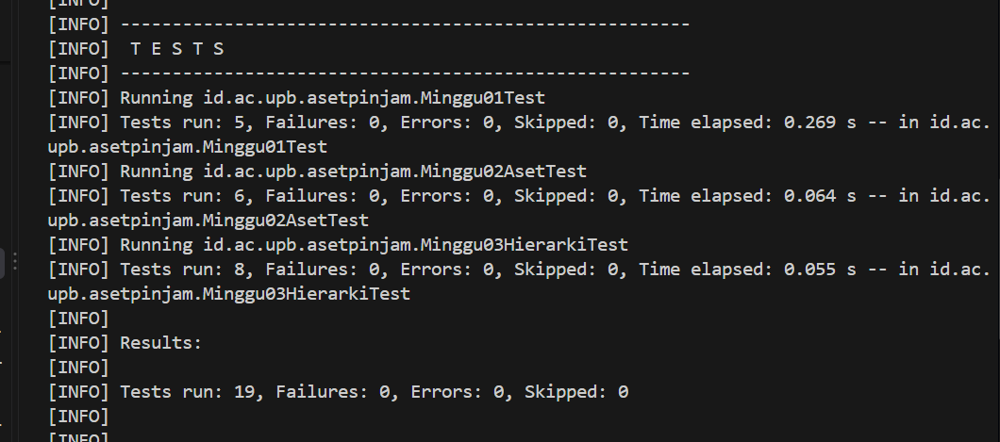
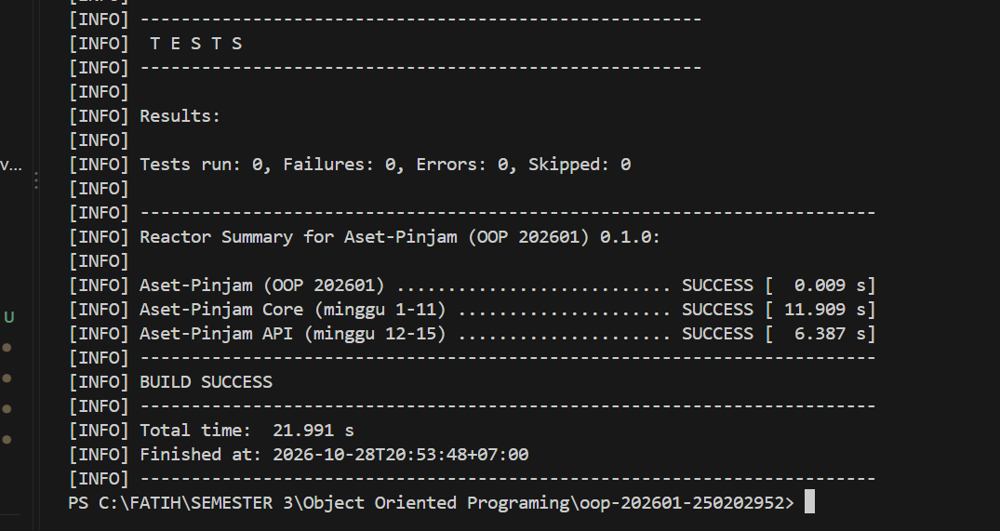

# Catatan Minggu 03: Inheritance

## Yang saya kerjakan
- Pada minggu ini, saya mengimplementasikan tiga subclass dari `Aset`, yaitu `Ruang`, `Laptop`, dan `AlatLab`. Setiap subclass memiliki atribut khusus: `Ruang` memiliki kapasitas, `Laptop` memiliki spesifikasi dan nomor inventaris, sedangkan `AlatLab` memiliki laboratorium dan tingkat risiko. 
- Pada setiap konstruktor, saya memanggil `super(kode, nama)` terlebih dahulu agar validasi pada kelas induk tetap berlaku, kemudian memvalidasi atribut milik subclass tersebut dan melempar `IllegalArgumentException` apabila data tidak memenuhi aturan. Selain itu, saya membuat getter untuk setiap atribut dan melakukan override pada `getJenis()` agar mengembalikan jenis aset yang sesuai.
- Hasil pengujian menunjukkan bahwa seluruh tes minggu 1 sampai 3 berhasil (19 tes tanpa kegagalan).

## Keputusan desain
- Atribut yang dimiliki oleh seluruh jenis aset ditempatkan pada kelas induk `Aset`, yaitu kode dan nama beserta validasinya. Atribut yang hanya relevan untuk satu jenis aset ditempatkan pada subclass masing-masing: kapasitas pada `Ruang`, spesifikasi dan nomor inventaris pada `Laptop`, serta laboratorium dan tingkat risiko pada `AlatLab`. Keputusan ini diambil karena atribut tersebut tidak bermakna bagi jenis aset lain. Apabila kapasitas ditempatkan pada `Aset`, maka `Laptop` dan `AlatLab` akan memiliki atribut yang tidak relevan dan harus diisi dengan nilai yang tidak berarti.
- Setiap subclass memanggil `super(kode, nama)` pada baris pertama konstruktor, sehingga validasi pada `Aset` tidak perlu ditulis ulang dan tetap berlaku. Validasi tambahan (kapasitas lebih dari 0; spesifikasi, nomor inventaris, dan laboratorium tidak boleh kosong; serta tingkat risiko tidak boleh null) ditulis pada masing-masing subclass karena aturan tersebut hanya berlaku untuk jenis aset yang bersangkutan.
- Method `getJenis()` di-override pada setiap subclass agar mengembalikan `JenisAset` yang sesuai.
## Kendala
- Kendala pertama muncul saat menjalankan pengujian di PowerShell. Skrip `uji.ps1` tidak dapat dijalankan karena kebijakan eksekusi (Execution Policy) pada Windows memblokir skrip. Saya mengatasinya dengan mengubah kebijakan tersebut hanya untuk sesi PowerShell yang sedang dibuka menggunakan `Set-ExecutionPolicy -Scope Process -ExecutionPolicy Bypass`, lalu `.\scripts\uji.ps1 03` sehingga setelah itu script berjalan

- Kendala kedua berkaitan dengan method `getJenis()` pada `Ruang`. Pada awalnya, method tersebut saya tulis dengan tipe kembalian `String`. Setelah memeriksa `Aset.java`, saya menemukan bahwa tipe kembalian yang benar adalah enum `JenisAset`, sehingga saya mengubahnya menjadi `JenisAset.RUANG`.

## Penggunaan AI
- Alat yang dipakai: Claude
- Bagian yang dibantu AI: Penjelasan konsep minggu ke 03 dan penjelasan dari inheritance, membantu memperbaiki eror pada saat mennjalankan  test
- Prompt utama: tolong jelaskan terlebih dahulu konsep minggu ke-3 ini, dan juga jelaskan secara singkat apa itu inheritance, gunakan bahasa yang sederhana.
- Yang saya ubah atau tolak dari saran AI, dan alasannya:Saran AI menggunakan `final` pada semua field. Pada `Ruang` dan `Laptop` saya tidak menerapkannya, sedangkan pada `AlatLab` saya menerapkannya.
- Satu hal yang saya pahami lebih baik sekarang:Pemanggilan `super(kode, nama)` pada baris pertama konstruktor membuat validasi kelas induk tetap berlaku pada subclass, sehingga saya tidak perlu menulis ulang validasi tersebut.

## Dokumentasi

