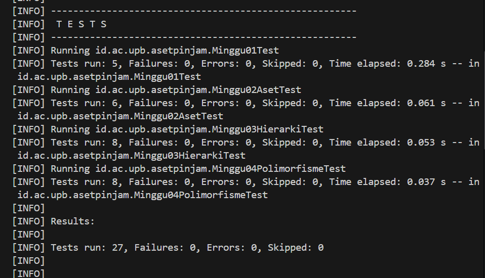
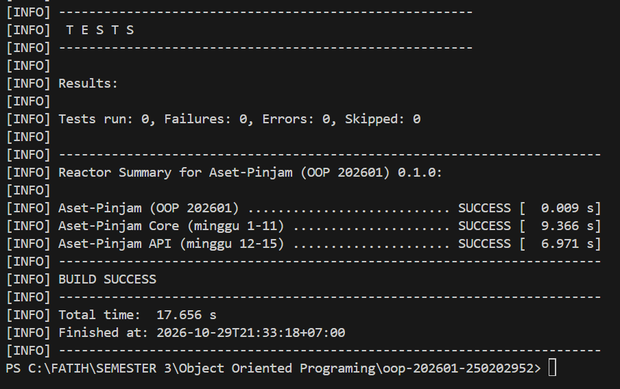

# Catatan Minggu 04: Polymorphism

## Yang saya kerjakan
- Mengerjakan method `hitungDenda(int)` di class `Aset` sebagai versi dasar, yaitu hari terlambat dikali tarif dari `Varian.aktif().dendaPerHari`, dan hari negatif ditolak dengan `IllegalArgumentException`.
- Meng-override method di `Ruang`, `Laptop`, dan `AlatLab` dengan multiplier 1x, 2x, dan 4x. Di `KatalogAset` saya membuat dua overload `cari(...)`: `cari(kata)` untuk mencari nama yang memuat kata tanpa membedakan huruf besar atau kecil, dan `cari(kata, jenis)` yang hanya mengambil aset dengan jenis tertentu. Dengan varian NIM saya (digit terakhir 2), tarif dasarnya Rp 10.000 per hari.

## Keputusan desain
Minggu ini tidak ada aturan bisnis yang harus saya putuskan sendiri karena aturannya sudah pasti, jadi saya tidak menambah catatan di `docs/asumsi.md`. Keputusan saya hanya soal cara menulis kode:

- Logika dasar `hitungDenda` (tolak hari negatif, hari dikali tarif) saya tulis sekali di `Aset`. Subclass memanggilnya lewat `super.hitungDenda(...)` lalu mengalikan dengan multiplier masing-masing (1x, 2x, 4x). Dengan begitu validasi tidak ditulis tiga kali, dan kalau aturannya berubah saya cukup mengubah satu tempat.
- Tarif tidak saya tulis sebagai angka langsung, tetapi dibaca dari `Varian.aktif().dendaPerHari`, sehingga mengikuti varian NIM saya dan tidak rusak kalau varian berbeda.
- `cari(kata, jenis)` memanggil `cari(kata)` lalu menyaring hasilnya berdasarkan jenis, agar aturan pencocokan nama (tanpa membedakan huruf besar atau kecil) tidak ditulis dua kali.
- Kasus 0 hari tidak saya beri `if` khusus, karena 0 dikali tarif sudah menghasilkan 0.

## Kendala
- Kendala pertama adalah class `Varian`. Saya mencari file `Varian.java` dan tidak menemukannya lewat pencarian awal, lalu saya baru tahu letaknya ada di package `config`. Karena itu muncul error `cannot find symbol: variable Varian` di `Aset.java`. Saya mengatasinya dengan menambahkan `import id.ac.upb.asetpinjam.config.Varian;`.

- Kendala kedua adalah error kompilasi saat menjalankan tes. Ada error `reached end of file while parsing` di `Laptop.java` dan `AlatLab.java` karena kurung kurawal penutup kurang, serta kesalahan kecil di `Aset.java`: baris `package` tertulis dua kali dan nama field salah ketik (`dendaPerhari` seharusnya `dendaPerHari`). Saya memperbaikinya satu per satu dengan membaca pesan error di terminal.

## Penggunaan AI
- Alat yang dipakai: Claude
- Bagian yang dibantu AI: 
    1. Penjelasan konsep (polymorphism, overriding, dynamic binding, overloading).
    2. Rancangan `hitungDenda` di `Aset`, `Ruang`, `Laptop`, `AlatLab`; dua method `cari` di `KatalogAset`.
    3. Membaca pesan error kompilasi.
- Prompt utama: 
    1. ini minggu ke 4, tolong jelaskan konsep minggu ke 4, gunakan bahasa yang sederhana.
    2. Saya menempelkan output error dari `.\scripts\uji.ps1 04` dan meminta bantuan memperbaikinya.
- Yang saya ubah atau tolak dari saran AI, dan alasannya:Saya tidak menolak saran, tetapi saya menyesuaikannya dengan struktur file saya dan memeriksa hasilnya lewat tes.
- Satu hal yang saya pahami lebih baik sekarang:Overriding ditulis di subclass dengan parameter yang sama, sedangkan overloading ada dalam satu class dengan parameter berbeda.

## Dokumentasi

